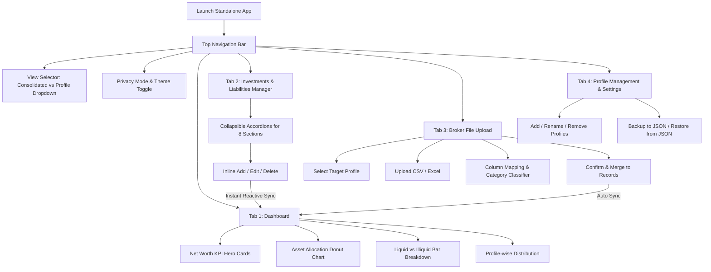

# Specification: Networth Tracker Desktop Application (SPEC.md)

**Version:** 1.0.0  
**Status:** Approved Specification & Implementation Roadmap  
**Target Platform:** Windows 10/11 Standalone Executable (`.exe`)  
**Data Privacy:** 100% Local & Offline (Zero Cloud Dependency, Zero Subscription)

---

## 1. Project Overview & Vision

The **Networth Tracker** is a modern, privacy-first personal wealth management desktop application. It enables individuals and families to consolidate, track, and visualize their total net worth across diverse asset classes, with seamless multi-profile support (e.g., Self, Spouse, Family, HUF).

### Core Formula
$$\text{Net Worth} = \sum(\text{Total Assets}) - \sum(\text{Total Liabilities})$$

Where:
* **Assets** = Equity + Mutual Funds + Bonds + Gold + Receivables + EPS Balance + NPS Balance
* **Liabilities** = Home Loans + Personal Loans + Car Loans + Credit Card Dues + Other Payables

---

## 2. Core Functional Requirements

### 2.1 Multi-Profile Management
* **Profile Attributes:** Profile ID, Name (e.g., *Self*, *Spouse*, *Parents*, *Family Trust*), Avatar/Color tag, Created Date.
* **CRUD Operations:**
  * Add new profile.
  * Rename or update profile details.
  * Delete profile (with safety guard: prompt to reassign existing holdings or delete them).
* **View Modes:**
  * **Consolidated View:** Aggregates holdings and net worth across all profiles into a single unified financial dashboard.
  * **Profile-Specific View:** Filters dashboard metrics, charts, and holdings for the selected profile only.

---

### 2.2 Investment & Liability Sections (Categorization)

The system supports 8 dedicated financial sections:

| Category | Type | Standard Fields | Specific Attributes |
| :--- | :--- | :--- | :--- |
| **📈 Equity** | Asset | Name/Ticker, Quantity, Avg Price, Current Price, Value | Exchange (NSE/BSE), Sector (Optional) |
| **📊 Mutual Funds** | Asset | Fund Name, Folio No., Units, NAV, Current Value | Fund Type (Equity, Debt, Hybrid, Index) |
| **🏛️ Bonds** | Asset | Bond Name/Issuer, Face Value, Units, Coupon Rate, Value | Maturity Date, Interest Payout Cycle |
| **🪙 Gold** | Asset | Asset Name, Form, Quantity (Grams), Rate/Gram, Value | Form: SGB, Physical Gold, Gold ETF, Digital Gold |
| **🤝 Receivables** | Asset | Debtor/Description, Expected Date, Due Amount | Contact / Note, Status (Pending, Received) |
| **💼 EPS Balance** | Asset | Member ID / Employer Name, Balance Amount | Pension account details, Last contribution date |
| **🛡️ NPS Balance** | Asset | PRAN Number, Tier (Tier 1 / Tier 2), Current Balance | Fund Manager, PFM Allocation |
| **💳 Liabilities** | Liability | Loan/Card Name, Institution, Outstanding Principal | Interest Rate (%), EMI Amount, Tenure Remaining |

---

### 2.3 Single-Page Collapsible Category Management
* **Layout:** A unified, clean management page featuring **collapsible accordion sections** for each of the 8 categories.
* **Header Indicators:** Each accordion header displays:
  * Category Icon & Title
  * Item count badge (e.g., `12 items`)
  * Total current value badge (e.g., `₹ 24,50,000`)
  * Quick "+ Add Record" button
* **Inline Actions per Record:**
  * **Edit:** Quick modal or inline row edit for instant correction.
  * **Delete:** One-click removal with confirmation toast.
  * **Profile Tagging:** Change profile association at any time.
* **Instant Reactivity:** Any add, update, or delete operation immediately updates the in-memory state store and recalculates net worth and chart distributions in real time without requiring a manual refresh.

---

### 2.4 Broker File Upload & Intelligent Classification
* **Supported Formats:**
  * CSV (`.csv`)
  * Excel (`.xlsx`, `.xls`)
* **Compatible Brokers/Formats:**
  * Zerodha Console Holdings Statement
  * Groww Holdings
  * CAMS / KFintech Consolidated Account Statement (CAS)
  * Generic broker trade/holdings sheet
* **Upload & Mapping Workflow:**
  1. **Upload Initiation:** User selects target profile and drops/selects the file.
  2. **Column Mapping Wizard:** User maps file columns to standard system fields (Name, Quantity, Price, Current Value). Smart presets auto-detect common broker headers.
  3. **Classification & Review Screen:**
     * Table displaying all parsed rows.
     * Dropdown selector per row to categorize each asset into Equity, Mutual Funds, Bonds, Gold, etc.
     * Batch classification options (e.g., "Classify all as Equity").
  4. **Confirmation & Merge:** User reviews totals and confirms. Records are appended or merged into the target profile.

---

### 2.5 Dashboard & Visual Analytics
* **Summary KPI Cards:**
  * **Total Net Worth** (Highlighted hero card with ₹ / $ formatting).
  * **Total Assets** (Sum of all positive categories).
  * **Total Liabilities** (Total outstanding debt).
  * **Debt-to-Asset Ratio** (Health indicator: `< 30%` Healthy, `30-50%` Moderate, `> 50%` Alert).
* **Interactive Charts:**
  * **Asset Allocation Donut Chart:** Breakdown across Equity, Mutual Funds, Gold, Bonds, Retirement (EPS/NPS), and Receivables.
  * **Liquid vs Illiquid Assets Chart:** Differentiates readily accessible funds (Equity, MFs, Gold, Receivables) from lock-in wealth (EPS, NPS, Real Estate/Bonds).
  * **Profile Breakdown Chart:** Visual comparison of wealth distribution across family members (in Consolidated view).
* **Profile Filter Switch:** Instant toggle between Consolidated and individual profiles.

---

### 2.6 Monthly Snapshots & Historical Net Worth Trajectory
* **Milestone Freezing**: Users can record a snapshot of their total wealth (Net Worth, Total Assets, Total Liabilities, Category breakdown) at any point in time (e.g., *Nov 2026*, *Dec 2026*).
* **Automatic Pre-Import Snapshots**: When loading a new monthly broker statement (e.g. for December), the app can automatically freeze and save the November snapshot before applying changes.
* **Growth Trajectory Visualization**: An interactive Area Chart on the Dashboard charts monthly wealth progression over time, displaying milestone dates, values, and monthly deltas (+₹ X, +Y%).
* **Milestone Manager**: Dedicated history table to view, inspect, or remove past snapshots.

---

### 2.7 Broker Update Strategies (New Monthly Statements)
When importing monthly updates, the user chooses from three explicit update strategies:
1. **Smart Sync & Update (Default & Recommended)**: Matches existing holdings by instrument name/ISIN. Updates latest market price, units, and present valuation. Inserts newly bought instruments. Preserves custom notes and non-broker categories.
2. **Replace Demat Holdings**: Overwrites existing holdings for that profile within the imported categories (Equity, MFs, Gold, Bonds). Non-broker categories (EPF, NPS, Loans, Receivables) are 100% preserved.
3. **Append All as New**: Adds all entries alongside existing records (ideal for importing statements from a second broker).

---

### 2.8 Suggested High-Value Features (Included in Planning)
1. **Privacy Mode (Stealth Mode):** One-click toggle in the header that blurs all numeric figures (e.g., `₹ •••••••`), perfect for using the app in public or sharing screenshots.
2. **Indian Rupee Formatting (Lakhs / Crores) & Currency Selector:** Option to toggle between Indian numbering (`₹ 12,34,567`) and Western numbering (`₹ 1,234,567`).
3. **Local JSON Backup & Restore:** Export complete database to a single `.json` file and restore at any time for effortless migration and peace of mind.
4. **Target Allocation vs. Actual Allocation:** Set desired target percentages (e.g., Equity 60%, Debt 20%, Gold 10%, Cash 10%) and view rebalancing hints.
5. **Dark Mode & Modern Clean Design:** Professional fintech aesthetic with high visual clarity, subtle borders, and accessible color palettes.

---

## 3. Architecture & Technology Stack

### 3.1 Technology Evaluation
| Layer | Selected Tech | Rationale |
| :--- | :--- | :--- |
| **Desktop Shell** | **Electron** | Cross-platform, reliable standalone `.exe` packaging via `electron-builder`, zero web-browser popup quirks. |
| **Frontend Framework** | **React 19 + TypeScript** | Rock-solid reactivity, robust typing, reusable component architecture. |
| **Styling & UI** | **Tailwind CSS + Lucide Icons** | Modern fintech aesthetics, high responsiveness, accessible color contrasts. |
| **Charting Engine** | **Recharts** | Declarative, SVG-based, highly responsive donut and bar charts with smooth tooltips. |
| **File Parsing** | **SheetJS (xlsx) + PapaParse** | Blazing-fast client-side CSV & Excel parsing with zero server requirement. |
| **Local Storage** | **File-backed JSON Store (`lowdb` / atomic JSON file)** | Stored in `%APPDATA%\NetworthTracker\networth_data.json`. Fully inspectable, zero external database installation, 100% portable. |
| **Packaging Tool** | **Electron Builder** | Compiles the entire application into a single self-contained Windows executable (`.exe`). |

---

### 3.2 Data Storage Model (JSON Schema)

```json
{
  "version": "1.0.0",
  "settings": {
    "currency": "INR",
    "numberFormat": "lakhs",
    "theme": "dark",
    "privacyMode": false
  },
  "profiles": [
    {
      "id": "prof_1",
      "name": "Self",
      "color": "#3B82F6",
      "isDefault": true,
      "createdAt": "2026-11-02T20:00:00Z"
    }
  ],
  "holdings": [
    {
      "id": "rec_001",
      "profileId": "prof_1",
      "category": "equity",
      "name": "Reliance Industries Ltd",
      "units": 50,
      "avgPrice": 2400.0,
      "currentPrice": 2750.0,
      "currentValue": 137500.0,
      "notes": "Zerodha Import",
      "lastUpdated": "2026-11-02T20:00:00Z"
    }
  ]
}
```

---

## 4. User Journey & Navigation Flow



---

## 5. Step-by-Step Implementation Roadmap

* **Step 1: Project Initialization & Build Harness**
  * Scaffold Vite + React + TypeScript + Tailwind CSS desktop app structure.
  * Configure Electron main process (`main.cjs`), preload script (`preload.cjs`), and secure IPC communication.
  * Initialize local data storage service in `%APPDATA%`.

* **Step 2: Profile Engine & Reactive State Store**
  * Implement centralized store with React Context / Zustand.
  * Implement Profile CRUD operations (create, edit, delete, set active).
  * Build Consolidated vs Single-Profile filtering mechanism.

* **Step 3: Collapsible Category Manager (Single Page)**
  * Build the accordion container with 8 section headers (Equity, MFs, Bonds, Gold, Receivables, EPS, NPS, Liabilities).
  * Implement table views, badges, and quick-add modals.
  * Implement instant reactive synchronization with the local store.

* **Step 4: Analytics Dashboard & Visualizations**
  * Implement Net Worth, Total Assets, Total Liabilities, and Debt Ratio KPI cards.
  * Integrate Recharts for category allocation donut chart and liquid vs illiquid breakdowns.
  * Connect profile filter to instantly recalculate all visualizations.

* **Step 5: Broker File Upload & Classification Wizard**
  * Build file drag-and-drop handler with SheetJS & PapaParse.
  * Implement column auto-detection and customizable category classification dropdowns for every imported record.
  * Provide review preview with total sum calculation prior to final commit.

* **Step 6: Smart Polish & Utilities**
  * Add Privacy Mode (blur financial amounts).
  * Add Indian Rupee formatting (`₹ Lakhs / Crores`).
  * Add Data Backup (`Export JSON`) and Restore (`Import JSON`).

* **Step 7: Windows Executable Packaging**
  * Configure `electron-builder` to generate a standalone `.exe` (portable or single installer).
  * Test build, verify offline functionality and data persistence.
